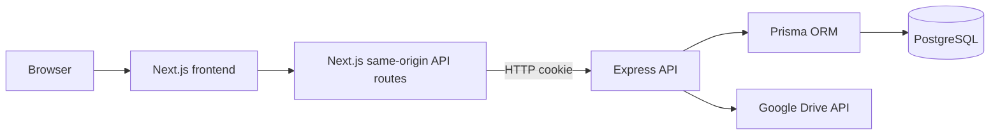

# Contract Forms Automation

Contract Forms Automation is a full-stack application for creating contract forms, evaluating bidders, managing supporting documents, running sequential approval workflows, and producing PDF records.

<p align="center">
  <a href="YOUR_YOUTUBE_VIDEO_LINK">
    
  </a>
</p>

## Intended users

- **SUBMITTER:** creates and owns contracts, saves drafts, attaches documents, submits contracts, and resubmits returned contracts.
- **APPROVER:** sees assigned approval work, reviews contract details, and approves, returns, or rejects a contract.
- **ADMIN:** manages users and reference data, publishes form schemas, and has organization-wide contract visibility.

## Implemented features

- Dynamic form schema draft, publish, and contract rendering
- Contract drafts and returned-contract resubmission
- Bidders, quotations, cost lines, and technical/commercial evaluations
- Role-based contract and dashboard visibility
- Sequential approval steps, decisions, history, notifications, and audit logs
- Supporting attachments, PDF viewing/download, and final PDF package generation
- Google Drive document storage when backend OAuth or service-account credentials are configured
- Admin user, approver, reference-data, and form-builder management

## Technology stack

| Layer | Verified technology |
|---|---|
| Frontend | Next.js 16.4.6, React 19.3, TypeScript 5, Tailwind CSS 4 |
| Backend | Node.js, Express 5.3, TypeScript 5.9 |
| Database | PostgreSQL with Prisma 6.19.3 |
| Authentication | HTTP-only `contract_token` JWT cookie and bcrypt password hashing |
| Documents | Multer, Google Drive API, PDFMake |
| Tests | Vitest and Supertest |
| Deployment | GitHub Actions and Azure App Service |

The repository `/.nvmrc` selects Node.js 24. Deployment workflows currently use Node.js 24, while backend deployment notes discuss Node.js 22; Node 24 is the command-tested repository convention.

## Architecture



The backend is mounted on `/api`. The frontend proxies non-authentication API requests through `/api/[...path]`; authentication uses dedicated `/api/auth/*` Next.js routes.

## Quick start

Prerequisites:

- Node.js 24 and npm
- Git
- PostgreSQL
- Optional Google Drive credentials and approved folder

Backend:

```powershell
cd backend
Copy-Item .env.example .env
npm ci
npm run db:generate
npm run dev
```

Frontend, in a second terminal:

```powershell
cd frontend
Copy-Item .env.example .env.local
npm ci
npm run dev
```

Frontend: `http://localhost:3000`
Backend: `http://localhost:4000`
Health: `http://localhost:4000/api/health`
Database health: `http://localhost:4000/api/health/db`

Use a dedicated local/development database. Never run migration reset or destructive seed commands against a shared or production database.

Detailed setup: [17-setup-guide.md](docs/17-setup-guide.md)

## Environment variables

Backend examples are in [backend/.env.example](backend/.env.example) and [backend/.env.production.example](backend/.env.production.example).

Required backend variables:

- `DATABASE_URL`
- `JWT_SECRET` (at least 32 characters)

Frontend server-only variable:

- `API_BASE_URL` or fallback `NEXT_PUBLIC_API_BASE_URL`

The frontend API URL must point to a base ending in `/api` and must use HTTPS outside local development.

Never commit real credentials or place backend secrets in `NEXT_PUBLIC_*` variables.

## Azure deployment

Deployment templates and scripts are in [docs/11-azure-deployment.md](docs/11-azure-deployment.md), [backend/deploy/azure/](backend/deploy/azure), and [GitHub Actions workflows](.github/workflows).

Verified deployed application URLs:

- Frontend: https://contract-forms-frontend-261126.azurewebsites.net
- Backend API: https://contract-forms-backend-261126.azurewebsites.net/api
- Login: https://contract-forms-frontend-261126.azurewebsites.net/login

Live health and database health endpoints were both verified with HTTP 200.

## Assessment route

Use isolated demo accounts only. The demo seed script defines:

- `admin@example.com`
- `approver@example.com`
- `submitter@example.com`

Passwords are intentionally displayed by the demo seed script. Do not copy them into public pages or production documentation. Obtain a demo account through an authorized project maintainer before testing.

Follow [19-assessment-guide.md](docs/19-assessment-guide.md) for the contract and approval workflow.

## Documentation index

- [Documentation inventory and verification status](docs/00-documentation-audit.md)
- [Project setup](docs/17-setup-guide.md)
- [Architecture](docs/03-system-architecture.md)
- [Database design](docs/05-database-design.md)
- [Database schema](docs/database-schema.md)
- [API documentation](docs/06-api-documentation.md)
- [API collection](docs/api-collection.json)
- [Google Drive setup](docs/09-google-drive-integration.md)
- [File access security](docs/20-file-access-security.md)
- [PDF generation](docs/10-pdf-generation.md)
- [Azure deployment](docs/11-azure-deployment.md)
- [User and approval workflows](docs/07-user-workflow.md)
- [Approval workflow](docs/08-approval-workflow.md)
- [Assessment guide](docs/19-assessment-guide.md)
- [Testing strategy](docs/13-testing-strategy.md)
- [Comprehensive QA report](docs/18-comprehensive-qa-report.md)
