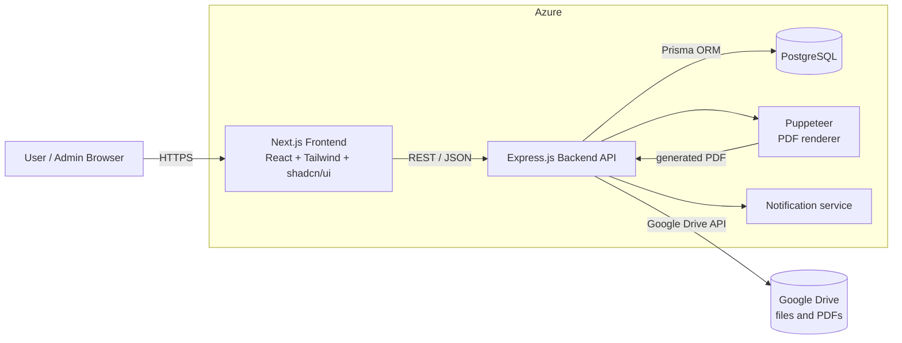

# 03. System Architecture

## Overview
A three-tier web application. The browser talks to a Next.js frontend, which calls an Express REST API. The API uses PostgreSQL (via Prisma) for structured data and Google Drive for files. Puppeteer renders PDFs on the backend. Everything is deployed on Microsoft Azure.

## Diagram

## Responsibilities

### Frontend (Next.js, React, Tailwind CSS, shadcn/ui)
- Pages and routing (login, dashboard, forms, drafts, approvals, documents, admin).
- Form UI using React Hook Form with Zod schemas for client-side validation.
- Calls the backend through a service layer (`src/services`).
- Shows or hides UI by role, **for convenience only**. The backend is the authority.

### Backend (Node.js, Express.js)
- REST API, organized in feature modules (`routes → controller → service`).
- Authentication, RBAC and ownership checks in middleware.
- Server-side Zod validation of every request.
- Business rules: draft/submit rules, approval sequencing, audit logging.
- Orchestrates Google Drive uploads/downloads and Puppeteer PDF generation.
- Creates notifications for the next approver.

### PostgreSQL + Prisma
- Source of truth for all structured data: users, forms, vendors, bidders, evaluations, estimates, approvals, history, document **metadata**, audit logs, notifications.
- Schema and migrations managed by Prisma.

### Google Drive
- Stores the **file contents** of supporting documents, Excel estimates and generated PDFs.
- PostgreSQL stores only metadata and the Drive file ID. See [09-google-drive-integration.md](09-google-drive-integration.md).

### Puppeteer
- Renders an HTML template populated from form data into PDF. See [10-pdf-generation.md](10-pdf-generation.md).

### Microsoft Azure
- Hosts the frontend, backend and managed PostgreSQL; holds environment configuration and secrets. See [11-azure-deployment.md](11-azure-deployment.md).

## Key Design Principles
1. **Backend is the security boundary**: never trust the client.
2. **Module isolation**: each backend module owns its routes, controller, service and validators so developers can work in parallel.
3. **Shared contracts**: Zod schemas mirror between frontend and backend (kept in sync by convention).
4. **Files outside the database**: only metadata in PostgreSQL.
5. **Everything auditable**: significant actions write to the audit log.

## Typical Request Flow
`Browser → Next.js page → service function → Express route → auth middleware → RBAC/ownership middleware → Zod validator → controller → service → Prisma/Drive → JSON response`
