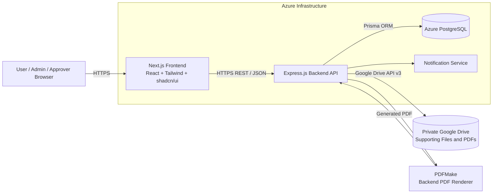

# 03. System Architecture

## Overview

Contract Forms Automation is a three-tier web application built using Next.js, Express.js, and PostgreSQL.

The frontend communicates with the Express REST API over HTTPS. The backend manages authentication, authorization, business logic, database operations, document storage, approval workflows, and PDF generation.

PostgreSQL, accessed through Prisma ORM, is the source of truth for structured application data. Google Drive stores supporting document files and generated contract PDFs. PDFMake generates PDFs inside the backend application.

The application architecture uses Microsoft Azure for hosting the frontend, backend, and managed PostgreSQL database.

## Architecture Diagram



## Component Responsibilities

### 1. Frontend — Next.js, React, Tailwind CSS, shadcn/ui

The frontend provides the application's user interface and handles user interactions.

Responsibilities:

- Pages and navigation for login, dashboard, contract forms, drafts, approvals, documents, and administration.
- Dynamic contract form interfaces.
- Form handling using React Hook Form.
- Client-side validation using Zod schemas.
- API communication through the frontend service layer (`src/services`).
- Displaying contract status, approval history, and comments.
- Role-based UI visibility for submitters, approvers, and administrators.

**Security note:** Frontend role checks are only for user experience. All permissions and access restrictions are independently enforced by the backend.

### 2. Backend — Node.js, Express.js, TypeScript

The backend is responsible for application logic, security, and integration with external services.

Responsibilities:

- Exposes REST APIs for frontend operations.
- Handles authentication and JWT-based sessions using secure HttpOnly cookies.
- Enforces role-based access control and resource ownership.
- Validates incoming requests using server-side Zod schemas.
- Implements contract creation, editing, draft saving, and submission rules.
- Manages sequential approval workflows.
- Records approval actions and audit history.
- Handles user, vendor, bidder, quotation, evaluation, and cost estimate operations.
- Orchestrates Google Drive uploads and authorized downloads.
- Generates contract PDFs using PDFMake.
- Manages notifications associated with approval workflow actions.

The backend follows a modular structure with routes, controllers, services, and validation logic.

### 3. PostgreSQL and Prisma ORM

PostgreSQL is the primary relational database and source of truth for structured application information.

It stores:

- User accounts and role information.
- Department, vendor, vendor type, and currency records.
- Contract forms and their form schema versions.
- Bidder and quotation information.
- Cost estimate records.
- Technical and commercial evaluation data.
- Approval steps, decisions, and history.
- Attachment metadata and Google Drive file IDs.
- Audit logs and notification records.

Prisma ORM provides database access and manages the database schema through version-controlled migrations.

### 4. Google Drive

Google Drive is used as private file storage for supporting documents, Excel estimates, and generated contract PDFs.

Responsibilities:

- Stores the actual uploaded file contents.
- Organizes files within the application's Drive folder structure.
- Provides file identifiers used by the backend to retrieve documents.
- Supports authorized file viewing and downloading.

PostgreSQL stores the associated metadata, including contract association, Drive file ID, filename, category, uploader, and upload information.

Files are not made publicly accessible. The backend verifies permissions before allowing document access.

Refer to `09-google-drive-integration.md` for integration details.

### 5. PDFMake

PDFMake is integrated into the Express backend as an in-process PDF renderer.

Responsibilities:

- Generates contract PDFs from persisted application data.
- Includes contract details, bidder information, cost estimates, supporting document information, and approval history.
- Uses the contract's associated form schema version when rendering dynamic form fields.
- Produces the final PDF after the approval workflow is completed.
- Sends generated files to Google Drive for private storage.

Refer to `10-pdf-generation.md` for the PDF structure and generation workflow.

### 6. Microsoft Azure

Microsoft Azure provides the application's hosting and database infrastructure.

The deployed architecture includes:

- Azure App Service for the Next.js frontend.
- Azure App Service for the Express.js backend.
- Azure Database for PostgreSQL Flexible Server for structured application data.
- Application environment settings for service configuration and secrets.
- HTTPS communication between the frontend and backend.

Google Drive remains an external file storage integration accessed securely by the backend.

Refer to `11-azure-deployment.md` for deployment architecture and configuration details.

## Key Design Principles

1. **Backend as the security boundary:** The backend is responsible for authentication, authorization, ownership checks, and validation. Client-side checks are never treated as sufficient security.

2. **Modular architecture:** Backend functionality is separated into feature modules, keeping routes, controllers, services, and validators organized.

3. **Consistent validation:** Zod is used for frontend and backend validation. Server-side validation remains authoritative.

4. **Separation of structured data and files:** PostgreSQL stores structured records and file metadata, while Google Drive stores actual file contents.

5. **Versioned form configuration:** Published form schemas are versioned so existing contracts retain the configuration associated with their creation.

6. **Auditability:** Significant contract, approval, and administrative actions are recorded for traceability.

7. **Secure document access:** Google Drive files remain private, and document access is controlled through backend authorization.

8. **Environment-based configuration:** Database connections, authentication secrets, API credentials, and service URLs are configured through environment variables rather than hardcoded values.

## Typical Request Flow

A typical authenticated application request follows this sequence:

```text
User Browser
     |
     v
Next.js Page / Component
     |
     v
Frontend Service Function
     |
     v
Express REST API Route
     |
     v
Authentication Middleware
     |
     v
RBAC / Ownership Middleware
     |
     v
Zod Request Validation
     |
     v
Controller
     |
     v
Service Layer
     |
     +------> Prisma ORM ------> PostgreSQL
     |
     +------> Google Drive API
     |
     +------> PDFMake
     |
     v
JSON / File Response
     |
     v
Frontend UI
```

For file downloads, the backend performs authorization checks before retrieving the private file from Google Drive and returning it to the authorized user.