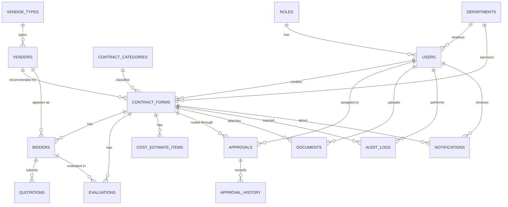

# 05. Database Design

> **All entities and fields are PROPOSED.** Final fields depend on company answers (CL-09, CL-10, CL-11, CL-12). Fields marked `(proposed)` are not established by the requirements and need confirmation. Only the structure below is established; no company-specific fields have been invented.

## ER Diagram

## Entities

### Users and roles
**roles**: `id`, `name` (USER, ADMIN; APPROVER pending CL-02).
**users**: `id`, `name`, `email` (unique), `password_hash`, `role_id`, `department_id (proposed)`, `is_active`, `created_at`, `updated_at`.

### Departments and reference data
**departments**: `id`, `name`.
**contract_categories**: `id`, `name`.
**vendor_types**: `id`, `name` (backs vendor type autocomplete).
Reference values are loaded by seed or Admin; actual values come from the company.

### Forms
**contract_forms**: `id`, `reference_no (proposed, CL-10)`, `title/project_name`, `sponsor_department_id`, `contract_category_id`, `scope`, `procurement_rationale`, `contract_amount`, `currency (proposed, CL-11)`, `recommended_vendor_id`, `selection_rationale`, `status` (DRAFT, PENDING_APPROVAL, APPROVED, REJECTED, RETURNED), `created_by`, `submitted_at`, `created_at`, `updated_at`.
Draft rows may have null values in required fields; required-ness is enforced at submit time.

### Vendors
**vendors**: `id`, `name`, `vendor_type_id`, `contact_details (proposed)`, `created_at`.

### Bidders and quotations
**bidders**: `id`, `form_id`, `vendor_id`, `sort_order`.
**quotations**: `id`, `bidder_id`, `quoted_amount`, `currency (proposed)`, `quotation_date (proposed)`, `notes (proposed)`.

### Evaluations
**evaluations**: `id`, `form_id`, `bidder_id`, `type` (TECHNICAL, COMMERCIAL), `score (proposed)`, `remarks`, `evaluated_by (proposed)`. Criteria structure pending CL-12.

### Cost estimates
**cost_estimate_items**: `id`, `form_id`, `description`, `quantity (proposed)`, `unit_cost (proposed)`, `amount`, `sort_order`.
Excel estimate files are stored in Drive and linked through `documents` (type `COST_ESTIMATE_EXCEL`).

### Approvals and history
**approvals**: `id`, `form_id`, `level` (sequence number), `approver_id`, `status` (WAITING, PENDING, APPROVED, RETURNED, REJECTED), `acted_at`.
**approval_history**: `id`, `approval_id`, `form_id`, `actor_id`, `action` (SUBMITTED, APPROVED, RETURNED, REJECTED, RESUBMITTED), `comment`, `created_at`. Append-only.

### Documents
**documents**: `id`, `form_id`, `type` (SUPPORTING, COST_ESTIMATE_EXCEL, GENERATED_PDF), `file_name`, `mime_type`, `size_bytes`, `drive_file_id`, `uploaded_by`, `created_at`. No file contents stored here.

### Audit logs
**audit_logs**: `id`, `actor_id`, `action`, `entity_type`, `entity_id`, `form_id (nullable)`, `details (JSON, proposed)`, `created_at`. Append-only; no update/delete endpoints.

### Notifications
**notifications**: `id`, `recipient_id`, `form_id`, `message`, `is_read`, `created_at`, `channel (proposed, CL-08)`.

## Relationship Rules
- A form has many bidders, evaluations, cost items, approvals, documents.
- Deleting a form is restricted pending CL-18; prefer status-based closure.
- `approval_history` and `audit_logs` are never edited.
- Indexes (proposed): `contract_forms(status, created_by)`, `contract_forms(sponsor_department_id)`, `approvals(approver_id, status)`, `audit_logs(entity_type, entity_id)`.
