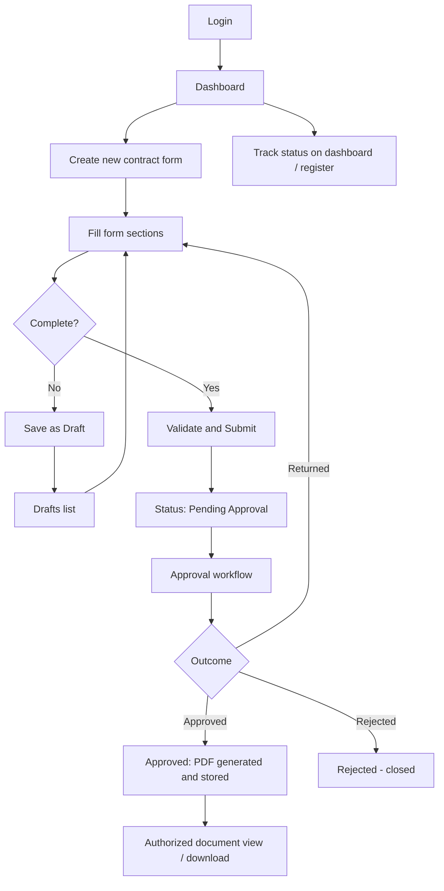

# 07. User Workflow

## Diagram

## Steps
1. **Login**: User signs in. The backend returns a token; the frontend routes to the dashboard. Admins also see the admin area.
2. **Dashboard**: Shows counts (total, draft, pending approval, approved, rejected/returned) and the searchable, filterable contract register.
3. **Create form**: User starts a new form and completes sections: project, sponsor department, category, scope, procurement rationale, vendor details, bidders and quotations, evaluations, cost estimate, supporting documents.
4. **Save draft**: At any point the user can save an incomplete form. Draft validation is relaxed (only basic type/format checks). Drafts appear on the Drafts page and can be resumed.
5. **Submit**: Submission runs full validation (frontend Zod + backend Zod). If valid, status becomes `PENDING_APPROVAL`, the form becomes read-only for the creator, and the first approver is notified.
6. **Track**: The dashboard and register show current status; the form detail page shows approval history and comments.
7. **If returned**: Creator sees the approver's comment, edits the form and resubmits (restart rule: CL-05).
8. **If rejected**: Form is closed (CL-07).
9. **Document retrieval**: After approval the generated PDF and supporting documents are available. Download goes through the backend, which checks permissions before streaming the file from Google Drive.

## Notes
- Users see only their own forms unless granted wider access (CL-15).
- Required fields per section depend on CL-09.
