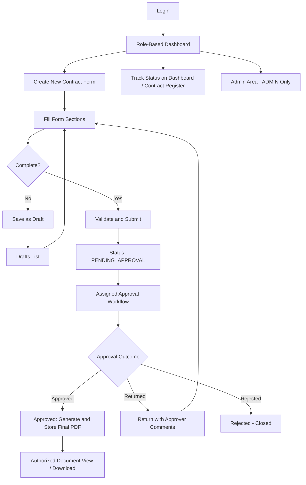

# 07. User Workflow

## Diagram

## User Roles

The application supports three roles:

| Role | Responsibilities |
|---|---|
| `SUBMITTER` | Creates and manages own drafts, submits contracts, tracks status, responds to returned forms, and accesses authorized documents. |
| `APPROVER` | Reviews assigned contracts, views submitted information, adds comments, and approves or returns contracts. |
| `ADMIN` | Manages users, roles, reference data, contracts, approval configuration, and administrative records. |

Access to forms, actions, and documents is controlled by backend role-based authorization.

## Workflow Steps

1. **Login:** The user signs in with valid credentials. The backend verifies the credentials and establishes an authenticated session using a secure HttpOnly cookie. The frontend redirects the user to the appropriate dashboard based on their role.

2. **Dashboard:** The dashboard displays contract statistics, including total contracts, drafts, pending approvals, approved contracts, and rejected or returned contracts. Users can search and filter the contract register according to their permissions.

3. **Create Contract Form:** A submitter starts a new contract form and completes the relevant sections:
   - Project identification
   - Sponsor department
   - Contract category and scope
   - Procurement and sourcing rationale
   - Vendor and contractor details
   - Bidders and quotations
   - Technical and commercial evaluations
   - Recommended vendor and selection rationale
   - Contract amount, budget, and cost estimates
   - Supporting documents

   The form uses the published form configuration available when the contract is created.

4. **Save as Draft:** The submitter can save an incomplete form at any point. Draft validation allows incomplete sections while checking basic data types and formats. Saved drafts appear in the Drafts section and can be reopened for further editing.

5. **Submit Contract:** When the form is ready, the frontend and backend perform submission validation using Zod schemas. Required fields and business rules are checked before submission. If validation succeeds, the contract status changes to `PENDING_APPROVAL`, and the form becomes read-only for the submitter while it is under review. The assigned approval workflow begins.

6. **Track Contract:** Users can track contract status through the dashboard and contract register. The contract detail page provides relevant information, including current status, approval history, and reviewer comments, subject to the user's permissions.

7. **If Returned:** If an approver returns a contract, the submitter can view the reviewer's comments, make the requested corrections, and resubmit the form. The resubmission follows the configured approval restart rule defined in CL-05.

8. **If Approved:** Once the required approval process is completed, the contract status becomes approved. The system generates the official final PDF and stores it in the contract's private Google Drive folder. The generated PDF is also associated with the contract through its attachment metadata.

9. **If Rejected:** If the contract is rejected, its status becomes rejected and the workflow is closed according to CL-07.

10. **Document Retrieval:** Authorized users can view or download generated PDFs and supporting documents. Document requests are routed through the backend, which verifies the user's permissions before retrieving or streaming the file from Google Drive.

## Workflow Rules and Notes

- **Form ownership (CL-15):** Submitters can access their own contracts. Wider access is granted only to users with the appropriate role or authorization.
- **Role-based access:** Submitters, approvers, and administrators have different permissions. Both frontend visibility and backend authorization are enforced.
- **Draft validation:** Incomplete forms can be saved as drafts, subject to basic validation.
- **Submission validation:** Full validation is performed before a contract enters the approval workflow.
- **Returned contracts:** The submitter must address the approver's comments before resubmission.
- **Rejected contracts:** Rejected contracts are closed according to the configured business rule.
- **Required fields (CL-09):** Required fields and validation rules depend on the applicable section and contract configuration.
- **Document security:** Google Drive files remain private. Access is granted through backend authorization rather than public file links.
- **Approval history:** Approval actions and relevant comments are maintained as part of the contract's approval history.