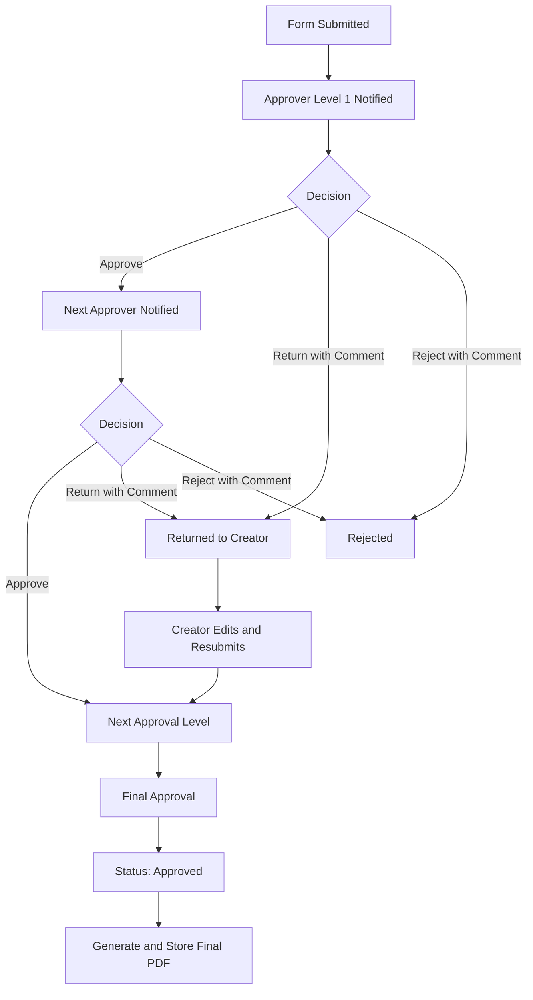

# 08. Approval Workflow

## 1. Overview

The Contract Forms Automation application uses a sequential, multi-level approval workflow to review submitted contract forms.

Once a submitter submits a contract form, it enters the approval process. Assigned approvers review the form in sequence and can approve, return, or reject it based on their decision.

Only the approver assigned to the current pending approval step can take action.

## 2. Approval Workflow Diagram

## 3. Approval Model

Each submitted contract form has an ordered list of approval steps.

Each approval step contains:

- Approval level
- Assigned approver
- Approval status
- Decision comment
- Decision timestamp

### Approval Step Statuses

| Status | Description |
|---|---|
| WAITING | The approval step has not started. |
| PENDING | The step is currently awaiting the assigned approver's decision. |
| APPROVED | The assigned approver has approved the form. |
| RETURNED | The form has been returned to the creator for corrections. |
| REJECTED | The form has been rejected. |

Only one approval step can be `PENDING` at a time. All subsequent steps remain `WAITING` until the previous step is approved.

### Resubmission After Return

When a form is returned:

1. The form status changes to `RETURNED`.
2. The creator receives the return comment.
3. The creator edits the required information.
4. The creator resubmits the form.
5. The workflow resumes according to the configured resubmission rule.

The documented workflow resumes at the returning approval level, while previously approved levels retain their approval status.

## 4. Approval Actions

| Action | Effect | Comment Requirement |
|---|---|---|
| Approve | Marks the current step as `APPROVED` and activates the next approval step. Final approval changes the form status to `APPROVED`. | Optional, subject to confirmation |
| Return | Changes the form status to `RETURNED` and sends it back to the creator for corrections. | Required |
| Reject | Changes the form status to `REJECTED` and ends the approval process. | Required |

After final approval, the application generates and stores the official final PDF.

## 5. Approval History and Audit Logging

Every approval action is recorded for traceability.

The approval history records:

- Contract form ID
- Approval level
- Approver/user ID
- Action performed
- Comment
- Action timestamp

A corresponding audit log entry is also created.

This provides a record of approval decisions and helps administrators track the complete approval lifecycle.

## 6. Approver Permissions

Approvers have restricted access based on their assigned approval responsibilities.

The following rules apply:

- Only the approver assigned to the current pending step can take an approval action.
- An approver cannot act on a step that is waiting, already approved, returned, or rejected.
- Approvers can view the contract form, supporting documents, and approval history when authorized.
- Approvers cannot edit the submitter's contract form content.
- Unauthorized, out-of-order, or duplicate approval actions are rejected by the backend.
- Invalid workflow state transitions return an HTTP `409 Conflict` response.

All permission checks are enforced on the backend, not only through frontend controls.

## 7. Notifications

The application supports in-app notifications for approval workflow events.

| Event | Notification Recipient |
|---|---|
| Form submitted | First assigned approver |
| Next approval step activated | Approver assigned to that step |
| Approval completed at an intermediate level | Creator |
| Form returned | Creator |
| Form rejected | Creator |
| Final approval completed | Creator |

Only the approver assigned to the current pending step receives the approval notification.

Email notifications depend on the confirmed notification configuration and company requirements.

## 8. Concurrency and Transaction Safety

Approval decisions are processed using database transactions.

Before applying a decision, the backend checks that:

1. The approval step exists.
2. The requesting user is the assigned approver.
3. The approval step is still `PENDING`.
4. The requested action is valid for the current workflow state.

This prevents two simultaneous requests from successfully deciding the same approval step.

If another request has already processed the decision, the subsequent request is rejected with an HTTP `409 Conflict` response.

## 9. Company Rules and Configuration

The following rules require confirmation against the company's approval policies.

| Reference | Rule | Details to Confirm |
|---|---|---|
| CL-03 | Approval levels | Number of approval levels and whether they depend on amount, category, or department. |
| CL-04 | Approver assignment | Who the approvers are and who assigns them. |
| CL-05 | Resubmission | Whether the workflow resumes at the returning level or restarts from the first level. |
| CL-06 | Delegation and reassignment | Whether approvers can delegate or reassign approval responsibilities and whether self-approval is prohibited. |
| CL-07 | Rejection | Whether rejection is always a final action. |
| CL-08 | Notifications | Whether notifications are in-app only or also sent through email. |
| Other | Approval requirements | Whether approval comments are mandatory and whether time limits or escalations apply. |

These configuration rules should follow the organization's confirmed approval policy.

## 10. Final Approval and PDF Generation

When all required approval steps are completed successfully:

1. The contract form status changes to `APPROVED`.
2. The final approval decision is recorded.
3. The application generates the official final PDF.
4. The generated PDF is stored in the contract's private Google Drive folder.
5. The attachment metadata is stored in the application database.
6. Authorized users can access the final PDF through the application's document download flow.

The final PDF represents the approved contract form and its recorded approval information.