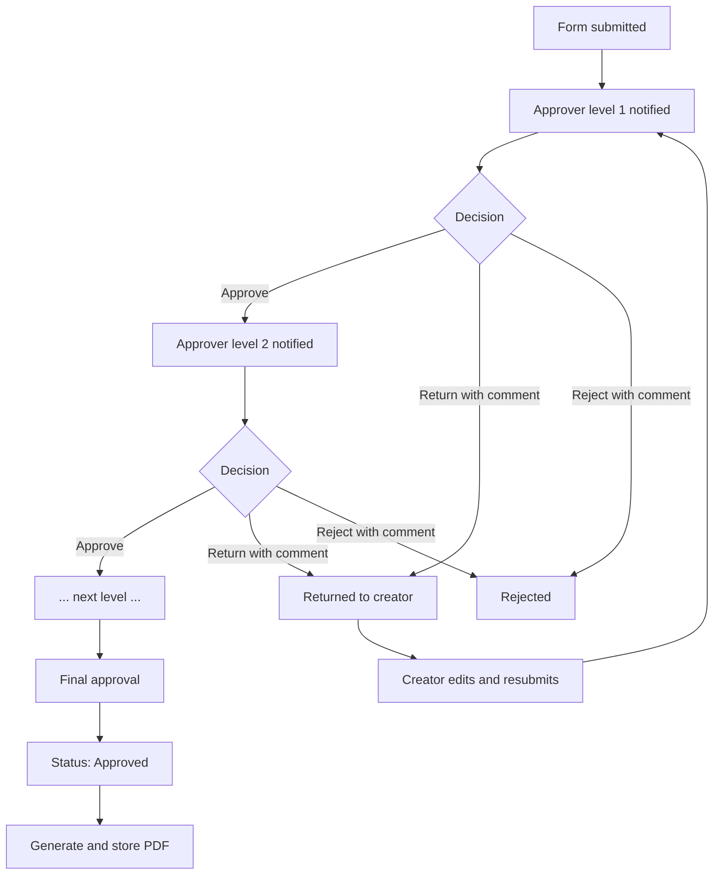

# 08. Approval Workflow

## Diagram

## Model
Each submitted form has an ordered list of approval steps (`approvals.level`). Only one step is `PENDING` at a time. Steps after it are `WAITING`.

## Actions
| Action | Effect | Comment |
|---|---|---|
| **Approve** | Marks the step APPROVED. Next step becomes PENDING and its approver is notified. Final approval sets the form to APPROVED. | Optional (confirm) |
| **Return** | Form goes back to creator with status RETURNED for correction. | **Required** |
| **Reject** | Form status becomes REJECTED. | **Required** |

Every action stores: actor, action, comment, and timestamp in `approval_history`, and writes an audit log entry.

## Approver Permissions
- Only the approver assigned to the **current pending step** can act.
- An approver cannot act on a step that is not pending or has already been decided.
- Approvers can view the form, its documents and history, but cannot edit form content.
- The backend rejects out-of-order or duplicate actions with `409`.

## Notifications
When a step becomes pending, the assigned approver receives a notification (in-app; email if confirmed, CL-08). The creator is notified on return, reject and final approval (proposed).

## Rules To Be Confirmed by the Company
| Ref | Rule |
|---|---|
| CL-03 | Number of levels; fixed vs. configured by amount/category/department |
| CL-04 | Who the approvers are and who assigns them |
| CL-05 | After return, restart at level 1 or resume at returning level |
| CL-06 | Delegation, reassignment, self-approval prohibition |
| CL-07 | Whether reject is final |
| CL-08 | Notification channels |
| Other | Whether approve comments are mandatory; any time limits/escalations |

## Concurrency
Decisions run inside a database transaction that checks the step is still `PENDING`, so two simultaneous actions cannot both succeed.
