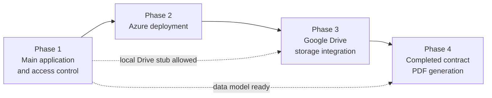

# 15. Four-Phase Implementation Plan

## Diagram

## Phase 1: Main Application and Access Control
**Objectives:** Build the working application with authentication, RBAC, forms, approvals and dashboard.
**Deliverables:**
- Prisma schema, migrations, seed data
- Login, JWT auth, User/Admin RBAC, admin management
- Contract form CRUD, drafts, vendors, bidders, evaluations, cost estimates
- Sequential approval workflow with history and audit log
- Notifications to next approver
- Dashboard and searchable register
- Basic document upload using a local storage adapter
**Dependencies:** CL-02 to CL-10, CL-15, CL-20 answers; setup guide complete.
**Responsible:** Dev 1 (auth, RBAC, dashboard, admin), Dev 2 (forms and related), Dev 3 (approvals, audit, notifications).
**Acceptance criteria:**
- All FR-01 to FR-16 work locally end to end
- RBAC enforced on the backend (tests pass)
- Full approval cycle (approve, return, reject) demonstrated
- Testing checklist sections for auth, permissions, forms, approvals, dashboard pass

## Phase 2: Azure Deployment
**Objectives:** Deploy the application on Azure with documented procedures.
**Deliverables:** Running frontend, backend and PostgreSQL on Azure; environment configuration; migrations applied; budget alert; credit expiry recorded; updated `11-azure-deployment.md`.
**Dependencies:** Phase 1 stable build; Azure subscription access (CL-17).
**Responsible:** Dev 3 (lead), Dev 1 and Dev 2 (support, smoke tests).
**Acceptance criteria:** Deployed app passes smoke test; no secrets in repo; budget alert active; deployment steps reproducible from documentation.

## Phase 3: Google Drive Storage Integration
**Objectives:** Store supporting documents and Excel estimates in Google Drive.
**Deliverables:** Drive client, folder-per-form structure, upload/download endpoints, metadata in PostgreSQL, access-controlled downloads; updated `09-google-drive-integration.md`.
**Dependencies:** Drive account/credentials (CL-16); file rules (CL-14); Phase 2 environment for deployed testing.
**Responsible:** Dev 3 (lead); Dev 2 (Excel upload integration); Dev 1 (permission checks).
**Acceptance criteria:** Files stored in Drive and not in DB; unauthorized access blocked; failure cases leave no orphan data; works in the Azure environment.

## Phase 4: Completed Contract PDF Generation
**Objectives:** Generate the completed contract PDF following the company's sample form.
**Deliverables:** HTML template, Puppeteer generator, 14 sections populated, PDF stored in Drive, generate/download endpoints; updated `10-pdf-generation.md`.
**Dependencies:** **Company sample PDF (CL-01)**; field list (CL-09); Phase 3 complete; Chromium available on Azure.
**Responsible:** Dev 3 (lead); Dev 2 (data mapping); Dev 1 (authorization and UI buttons).
**Acceptance criteria:** All 14 sections render correct data; layout approved against the sample; PDF stored and retrievable by authorized users only; works on Azure.

## Working in Parallel
Phases 2 to 4 depend on Phase 1 being stable, but Dev 3 can prepare Azure and Drive groundwork while Devs 1 and 2 finish Phase 1, provided interfaces (storage adapter, form data shape) are agreed first.
